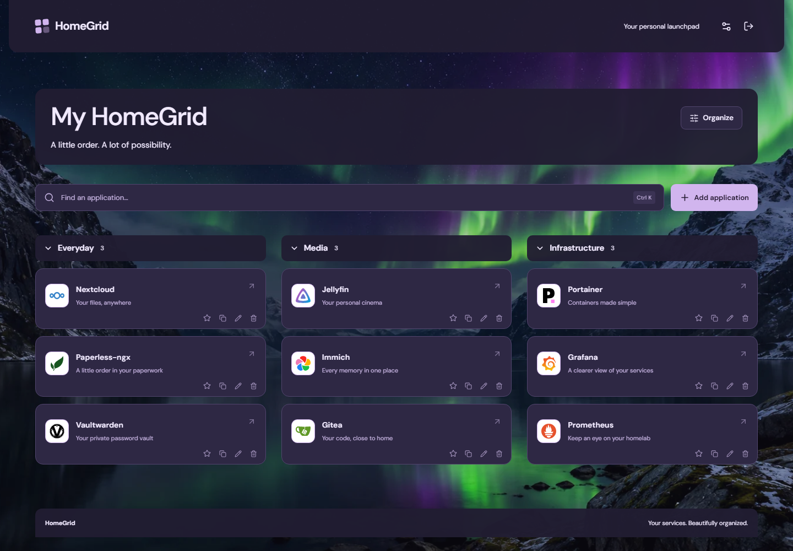
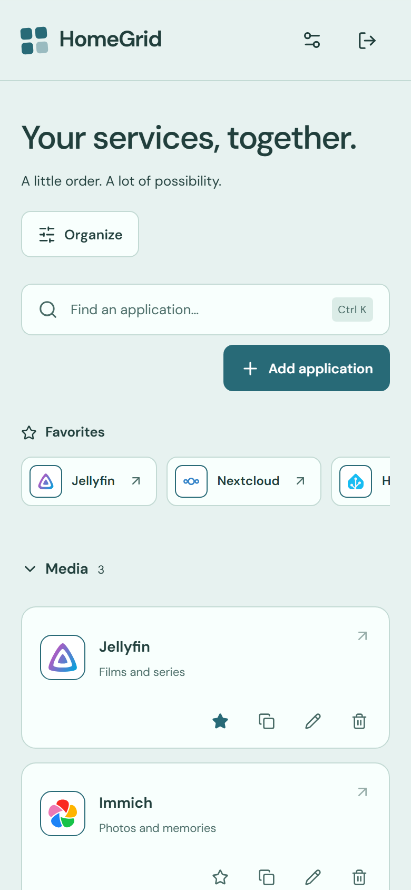
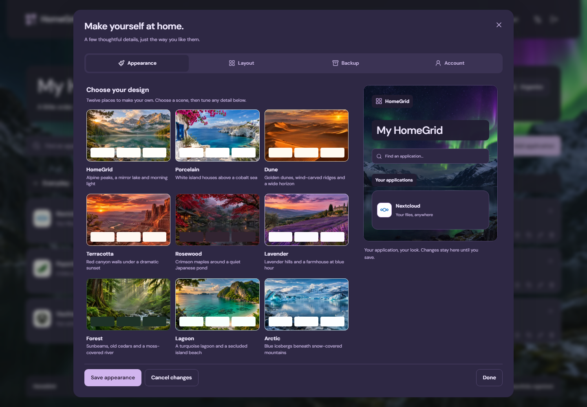

# HomeGrid

**Your services. Beautifully organized.**

A self-hosted homepage for your homelab. Add your applications, arrange them into
categories, and launch them from a dashboard that feels at home on any screen.
Built with Go, React, and SQLite; packaged as one container.



## Start with Docker

Save [docker-compose.yml](docker-compose.yml) in a directory on your Docker host.
It downloads the public image `ghcr.io/bifrost0x/homegrid:latest` and starts HomeGrid:

```sh
docker compose pull
docker compose up -d --wait
```

Open `http://<docker-host-ip>:8095` from your network, or
[localhost:8095](http://localhost:8095) on the Docker host, and create your
administrator account. There are no default credentials. Compose publishes on
all host interfaces by default; complete setup from a trusted network.

The image supports AMD64 and ARM64. Docker selects the matching architecture;
no Go, Node.js or source checkout is needed on the server.
See the [Docker guide](docs/docker.md) for LAN access, HTTPS, updates, backups
and optional local source builds.

## Make it yours

- **Add a service in seconds.** Choose from 341 categorized service templates with
  bundled logos and enter its URL. Or add any HTTP/HTTPS application manually:
  HomeGrid recognizes well-known services from the name, hostname or default
  port and selects their logo, which you can keep or undo. Existing
  applications and imports get the same recognition: HomeGrid offers the
  logos it finds for review, and never replaces an uploaded image. Search 385
  local icons, select a color, upload an image, or use its browser favicon.
- **Keep everyday tools close.** Favorite applications, duplicate an existing
  card, and find services with **Ctrl+K** or **Cmd+K**. Search includes names,
  descriptions and categories.
- **Organize in place.** Turn on **Organize** to arrange cards and categories
  with drag-and-drop, keyboard sorting or explicit controls. Move cards directly
  between categories, including empty or collapsed groups, with persisted undo.
  Empty categories stay out of the everyday launcher.
- **Choose your atmosphere.** Start from one of twenty presets, then adjust each
  layer on its own: light, dark or system mode; eighteen surface palettes; named,
  extra or custom accent colors; and a background that is none, one of twelve
  generated gradients, one of twelve bundled photographs or your own image.
  Adjust density, corners, descriptions, dashboard width, columns, and cards,
  tiles or lists.
- **Preview before saving.** Appearance and layout share a live draft. **Save**
  applies it; **Cancel changes** restores the saved settings. Supported deletions,
  ordering and appearance changes can be undone for 30 minutes, even after a
  restart. Undo refuses changes that conflict with later edits.
- **Keep your configuration portable.** Export and import applications,
  categories and appearance as JSON, with an import preview and merge or replace
  choices. Use a full data-volume backup to preserve uploaded files and accounts.

Optional example cards are explicitly unconfigured: supply your own service URL
before launching them. Screenshots show an example configuration.

<details>
<summary>Mobile and appearance previews</summary>





</details>

## Small by design

One Go executable serves the embedded frontend and stores data in SQLite. The
container runs as UID/GID 65532, uses a read-only root filesystem, drops Linux
capabilities, and does not need the Docker socket. The named data volume holds
the database and uploads.

Bundled icons and backgrounds work offline. Optional browser favicon discovery
requests `/favicon.ico` directly from the service origin; browser access or
certificate restrictions can cause a fallback icon. HomeGrid does not monitor
services or fetch their URLs from the backend.

HomeGrid has one local administrator. Use an HTTPS reverse proxy when accessing
it over an untrusted network and enable secure cookies. There is no multi-user
management, external identity provider, recovery email or plugin system in 0.1.0.
See [security guidance](SECURITY.md) and [third-party icon credits](docs/third-party-icons.md).

## Configuration

Create `.env` beside `docker-compose.yml` to customize Compose, or use
[.env.example](.env.example) as a starting point from a source checkout.
Compose loads `.env` for variable interpolation; the native Go executable reads
process environment variables and does not automatically load dotenv files.

| Variable                   | Default                             | Purpose                                                                                 |
| -------------------------- | ----------------------------------- | --------------------------------------------------------------------------------------- |
| `HOMEGRID_BIND_ADDRESS`    | `0.0.0.0`                           | Compose host binding; use `127.0.0.1` for access only from the Docker host              |
| `HOMEGRID_PORT`            | `8095`                              | Compose host port                                                                       |
| `HOMEGRID_IMAGE`           | `ghcr.io/bifrost0x/homegrid:latest` | Container image; may also be pinned to a published digest                               |
| `TZ`                       | `UTC`                               | Container timezone                                                                      |
| `HOMEGRID_LISTEN`          | `127.0.0.1:8080`                    | Native HTTP listen address; Compose explicitly uses `0.0.0.0:8080` inside the container |
| `HOMEGRID_DATA_DIR`        | `./data`                            | Native data directory; `/data` inside Compose                                           |
| `HOMEGRID_SECURE_COOKIE`   | `false`                             | Set `true` when serving over HTTPS                                                      |
| `HOMEGRID_TRUSTED_PROXIES` | empty                               | Comma-separated CIDRs for proxies you control                                           |

## Development

Requirements: Go 1.27+, Node.js 26+, and npm. Node.js is needed for frontend
development and builds; it is not part of the production runtime.

```sh
cd frontend
npm ci
npm run build
cd ..
go run ./cmd/homegrid
```

Open [localhost:8080](http://localhost:8080). Build the frontend before compiling
Go because `web/dist` is embedded. For hot reload, run `npm run dev` from
`frontend` in another terminal and use the Vite URL for the entire session; it
proxies `/api` and `/uploads` to Go.

The development server also binds to localhost by default. After local setup,
`npm run dev -- --host 0.0.0.0` deliberately enables LAN development access;
the development proxy exposes the API on that interface too.

Native execution binds to localhost by default. Complete administrator setup
locally before deliberately exposing it to a network with `HOMEGRID_LISTEN`.
Docker's explicit internal binding is controlled separately from its host port.

```sh
go test ./...
go test -race ./...
go vet ./...
cd frontend
npm run typecheck
npm test
npm run build
```

Read the [changelog](CHANGELOG.md) and [0.1.0 release notes](docs/release-notes-0.1.0.md)
for the prepared first release.

## License

HomeGrid is licensed under the [Apache License 2.0](LICENSE).
Bundled third-party icons retain their respective licenses; see the
[icon credits](docs/third-party-icons.md).
