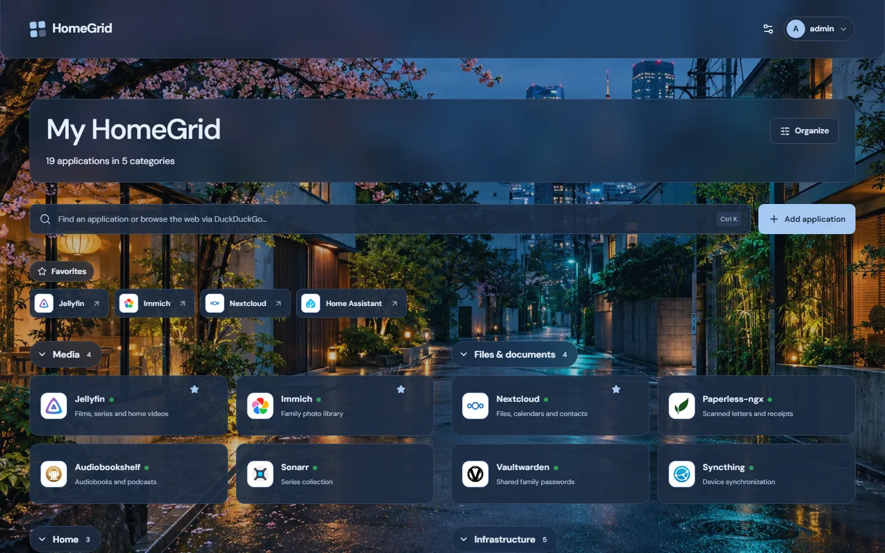
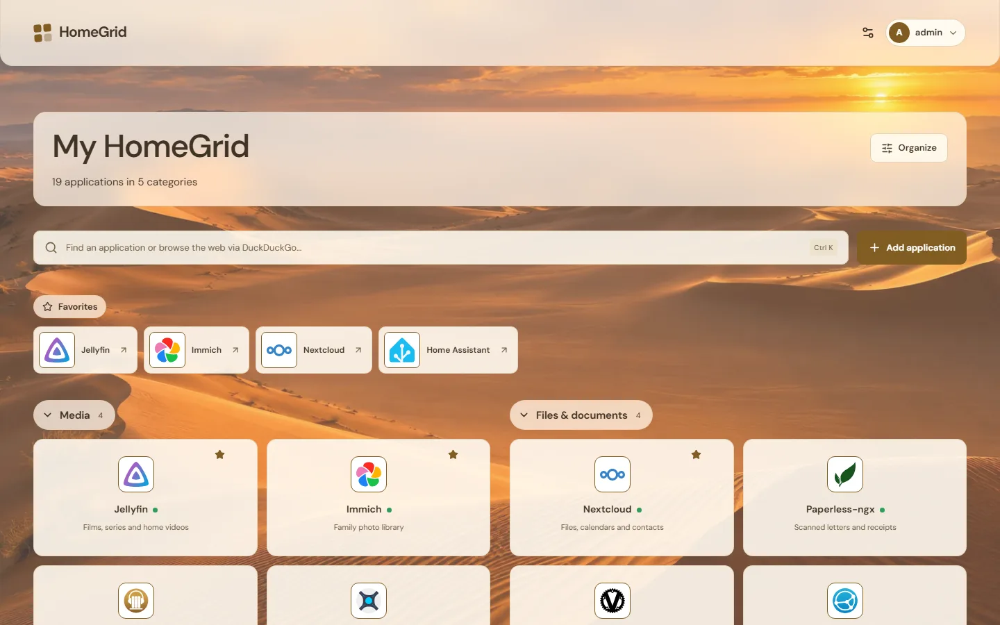
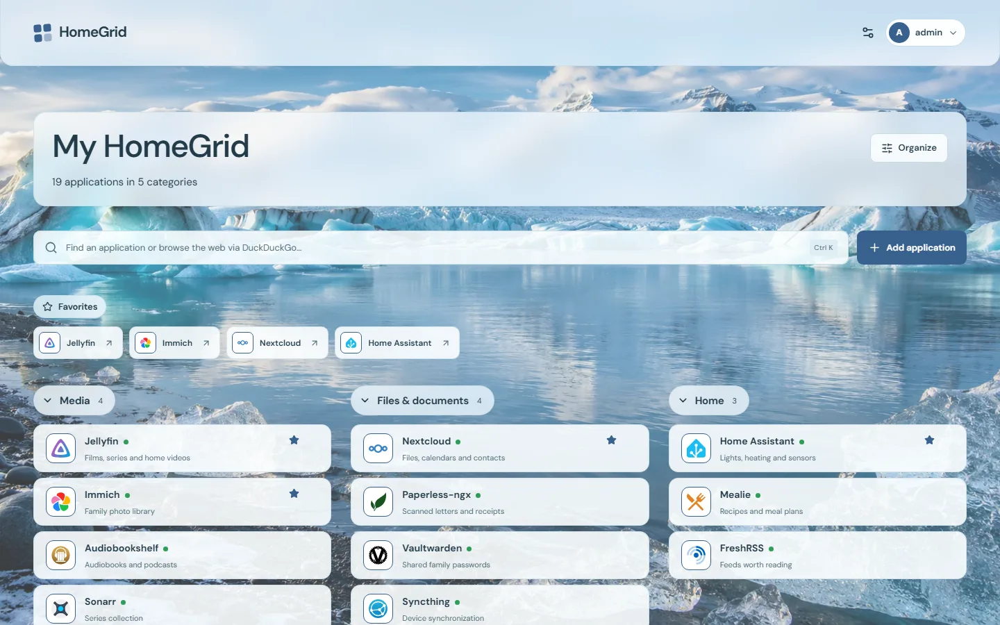
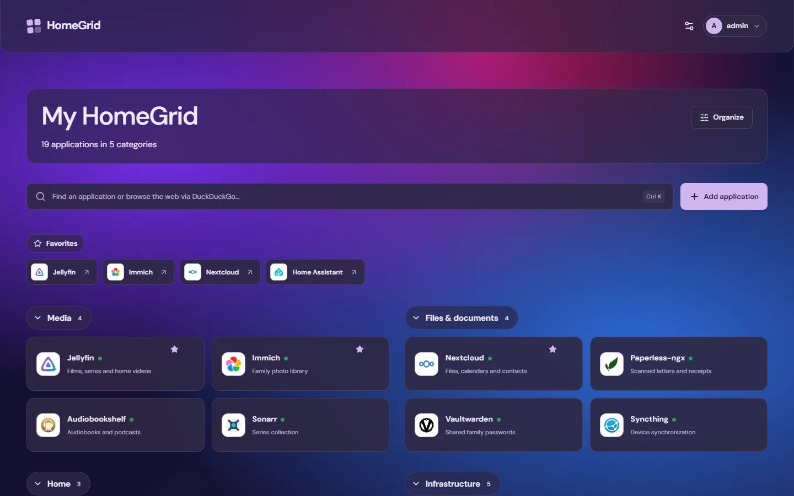
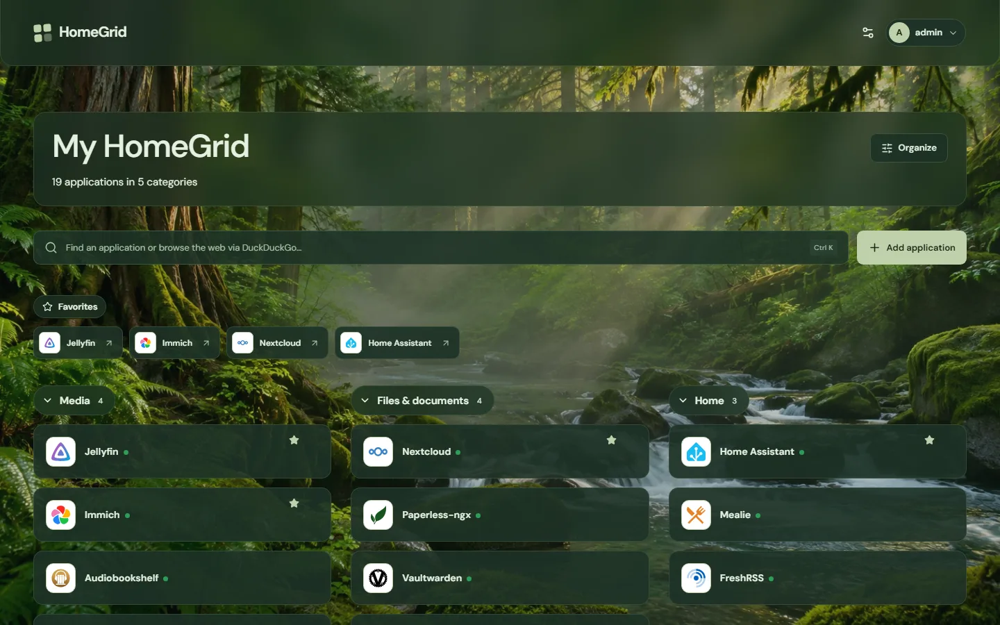
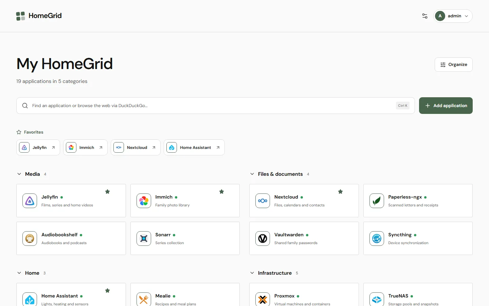
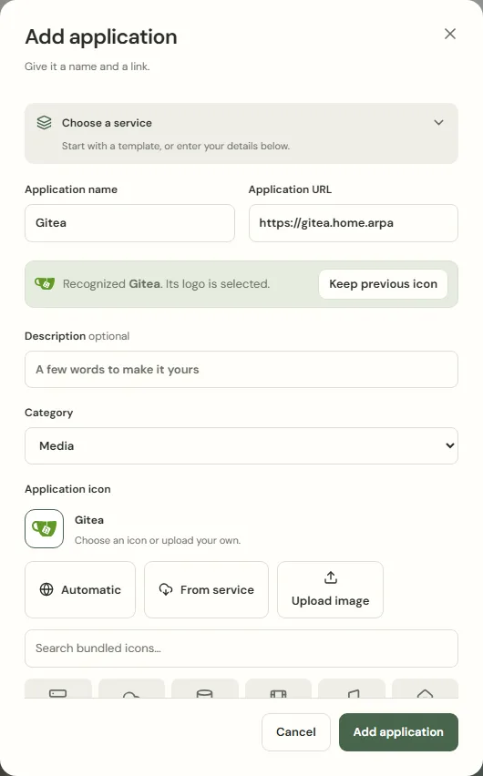
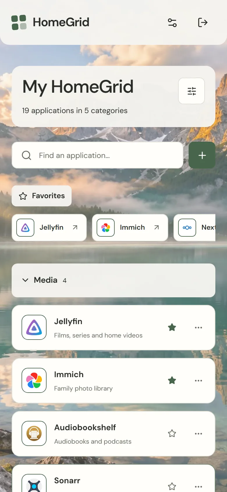
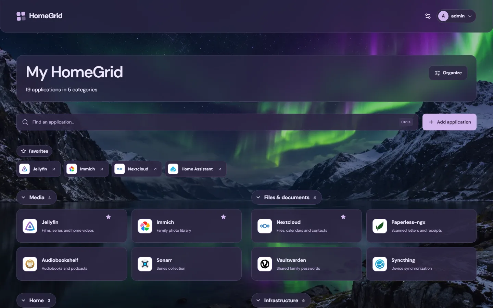
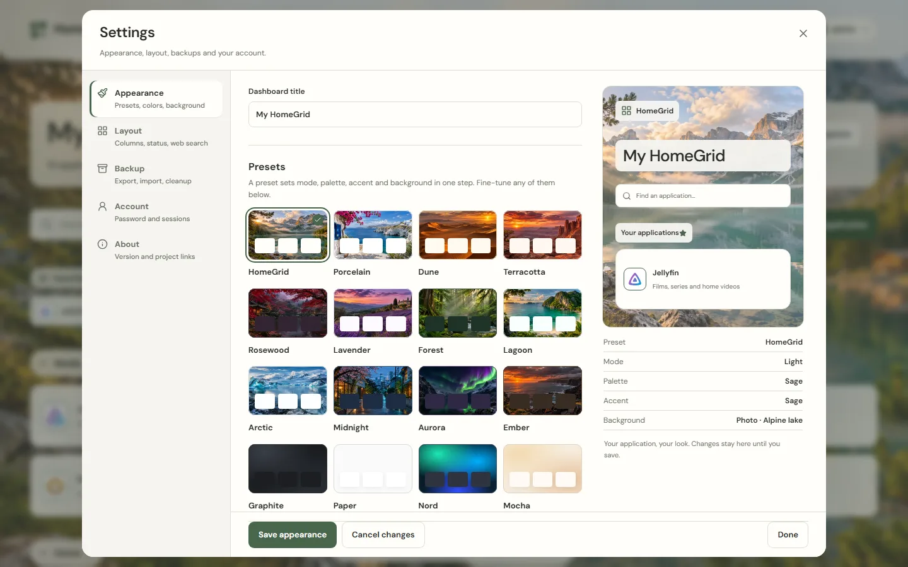

<div align="center">


# HomeGrid

**Your services. Beautifully organized.**

The self-hosted start page for your homelab: every service one click away,
recognized with its own logo, in a design that feels like yours. One small
container, no cloud, no telemetry.

[](https://github.com/bifrost0x/homegrid/releases)
[](LICENSE)
[](https://github.com/bifrost0x/homegrid/pkgs/container/homegrid)

[Website](https://bifrost0x.github.io/homegrid/) ·
[Quick start](#quick-start) ·
[Features](#what-you-get) ·
[Releases](https://github.com/bifrost0x/homegrid/releases) ·
[Support HomeGrid](#support-homegrid)


</div>

## Quick start

All you need is a machine with Docker. Download the Compose file of the
current release and start HomeGrid:

```sh
curl -fsSLo docker-compose.yml https://github.com/bifrost0x/homegrid/releases/download/v0.1.0/docker-compose-0.1.0.yml
docker compose up -d --wait
```

Open `http://<docker-host-ip>:8095` and create your administrator account.
There are no default credentials. Add your first service from 343 templates,
or import your existing Homepage, Homer or Dashy configuration.

The image runs on AMD64 and ARM64, including a Raspberry Pi with a 64-bit
operating system. Compose publishes
on all host interfaces by default, so complete the setup from a trusted
network. The [Docker guide](docs/docker.md) covers LAN access, HTTPS, updates,
backups and building from source.

## What you get


### A design for every taste

Start from one of twenty presets, then make it yours: light, dark or system
mode, eighteen surface palettes, named or custom accent colors, twelve bundled
photographs, twelve generated gradients or your own image. Show cards, tiles or
a list, one to three groups per row, compact or comfortable spacing, rounded or
square corners. Everything previews live and only applies when you save.

<table>
  <tr>
    <td></td>
    <td></td>
    <td></td>
  </tr>
  <tr>
    <td align="center"><b>Midnight</b> · dark, two groups</td>
    <td align="center"><b>Dune</b> · tiles</td>
    <td align="center"><b>Arctic</b> · list, three groups</td>
  </tr>
  <tr>
    <td></td>
    <td></td>
    <td></td>
  </tr>
  <tr>
    <td align="center"><b>Nebula</b> · generated gradient</td>
    <td align="center"><b>Forest</b> · compact</td>
    <td align="center"><b>Paper</b> · plain, square corners</td>
  </tr>
</table>

### Services that look right from the start

Type an address and HomeGrid recognizes the service from its name, hostname or
default port and picks its logo: 343 categorized templates and 2,629 bundled
icons, all offline. For anything it does not know, it can ask the service for
its own icon once.

<p align="center">
  
</p>

### Find anything in a keystroke

Press **Ctrl+K** or **Cmd+K** to search names, descriptions and categories.
If you like, the same search continues on the web with DuckDuckGo, Startpage,
Brave Search, Google, Bing or your own SearXNG. Favorites sit at the top.


### Move over in minutes

Bring your links from **Homepage** (`services.yaml`, `bookmarks.yaml`),
**Homer** (`config.yml`) or **Dashy** (`conf.yml`). HomeGrid takes over names,
links, descriptions and groups, recognizes the logos and shows a preview before
it changes anything. Widgets and templated links are skipped and counted.


### See what is online

Turn on **Show whether services are online** and a small dot next to each name
shows whether the service answers. It is off by default; when on, the server
sends one request per address at most once a minute and keeps no history.

### At home on every screen

Arrange cards and categories in **Organize** mode by drag-and-drop, keyboard or
touch, and undo deletions, reordering and appearance changes for 30 minutes.
Install HomeGrid on your phone's home screen or as a desktop app. You stay
signed in while you use it.

<p align="center">
  
  &nbsp;
  
</p>

### Everything else you would expect

- Export and import your configuration as JSON, with merge or replace.
- Review and delete icons and backgrounds that nothing uses anymore.
- One settings sheet for appearance, layout, backup, your account and version
  information.

<details>
<summary>More screenshots</summary>




</details>

Screenshots show an example configuration with fictional services.

## Small, private, secure

- **One container, one volume.** A single Go executable serves the web app and
  stores everything in SQLite. It runs as an unprivileged user on a read-only
  root filesystem, drops all Linux capabilities and never needs the Docker
  socket.
- **No cloud, no telemetry.** Logos, icons and backgrounds are bundled and work
  offline. The server only contacts a service when you ask it to: once to
  fetch a logo that is not bundled, and, if you turn status checks on, with one
  `HEAD` request per address at most once a minute. Both refuse loopback,
  link-local and multicast addresses and verify certificates. Addresses on the
  HomeGrid host itself, such as `localhost`, are never checked.
- **Built with care.** No default credentials, CSRF protection, strict content
  security policy, rate-limited sign-in and sessions that end seven days after
  their last use and always after 30 days. Releases ship with an SBOM, build
  provenance and a vulnerability scan.

HomeGrid has one local administrator. Use an HTTPS reverse proxy when you access
it over an untrusted network and enable secure cookies. Multi-user accounts,
external identity providers and plugins are not part of 0.1.0. See the
[security guidance](SECURITY.md) for details.

## Configuration

Create `.env` beside `docker-compose.yml` to customize Compose, or start from
[.env.example](.env.example). Compose loads `.env` for variable interpolation;
the native Go executable reads process environment variables and does not load
dotenv files.

| Variable                   | Default                             | Purpose                                                                                 |
| -------------------------- | ----------------------------------- | --------------------------------------------------------------------------------------- |
| `HOMEGRID_BIND_ADDRESS`    | `0.0.0.0`                           | Compose host binding; use `127.0.0.1` for access only from the Docker host              |
| `HOMEGRID_PORT`            | `8095`                              | Compose host port                                                                       |
| `HOMEGRID_IMAGE`           | `ghcr.io/bifrost0x/homegrid:latest` | Container image; pin a release such as `ghcr.io/bifrost0x/homegrid:0.1.0` or a digest   |
| `TZ`                       | `UTC`                               | Container timezone                                                                      |
| `HOMEGRID_LISTEN`          | `127.0.0.1:8080`                    | Native HTTP listen address; Compose explicitly uses `0.0.0.0:8080` inside the container |
| `HOMEGRID_DATA_DIR`        | `./data`                            | Native data directory; `/data` inside Compose                                           |
| `HOMEGRID_SECURE_COOKIE`   | `false`                             | Set `true` when serving over HTTPS                                                      |
| `HOMEGRID_TRUSTED_PROXIES` | empty                               | Comma-separated CIDRs for proxies you control                                           |

The Compose file of a release is pinned to that release's image. The
[`docker-compose.yml`](docker-compose.yml) in this repository follows `latest`,
which is published from `main`.

## Support HomeGrid

HomeGrid is free and open source, made with love for the homelab community. If
it makes your homelab a little nicer, you can support its development:

[GitHub Sponsors](https://github.com/sponsors/bifrost0x) ·
[Buy Me a Coffee](https://buymeacoffee.com/bifrost0x) ·
[Patreon](https://www.patreon.com/bifrost0x)

Bug reports and ideas are welcome as
[issues](https://github.com/bifrost0x/homegrid/issues/new/choose); see
[CONTRIBUTING.md](CONTRIBUTING.md) and the [roadmap](ROADMAP.md).

## Development

Requirements: Go 1.27+, Node.js 26+, and npm. Node.js is needed for frontend
development and builds; it is not part of the production runtime.

```sh
cd frontend
npm ci
npm run build
cd ..
go run ./cmd/homegrid
```

Open [localhost:8080](http://localhost:8080). Build the frontend before compiling
Go because `web/dist` is embedded. For hot reload, run `npm run dev` from
`frontend` in another terminal and use the Vite URL for the entire session; it
proxies `/api` and `/uploads` to Go.

The development server also binds to localhost by default. After local setup,
`npm run dev -- --host 0.0.0.0` deliberately enables LAN development access;
the development proxy exposes the API on that interface too.

Native execution binds to localhost by default. Complete administrator setup
locally before deliberately exposing it to a network with `HOMEGRID_LISTEN`.
Docker's explicit internal binding is controlled separately from its host port.

```sh
go test ./...
go test -race ./...
go vet ./...
cd frontend
npm run typecheck
npm test
npm run build
```

Read the [changelog](CHANGELOG.md) and [0.1.0 release notes](docs/release-notes-0.1.0.md).
Versioned images and GitHub releases are created from tags; see
[releasing](docs/releasing.md). Screenshots are captured with
`scripts/site-screenshots.mjs`.

## License

HomeGrid is licensed under the [Apache License 2.0](LICENSE).
Bundled third-party icons retain their respective licenses; see the
[icon credits](docs/third-party-icons.md).
